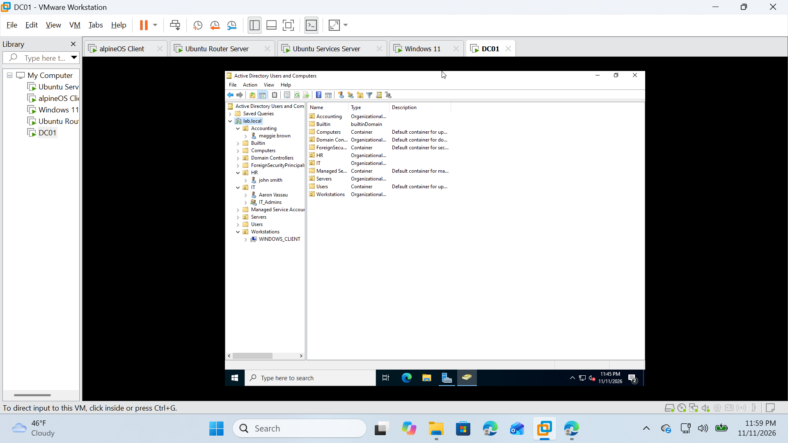
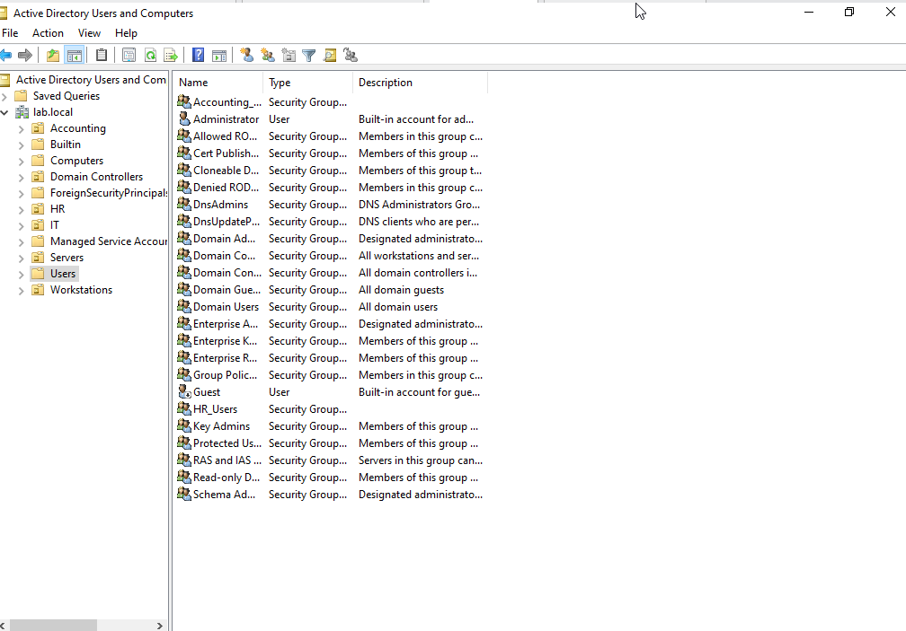
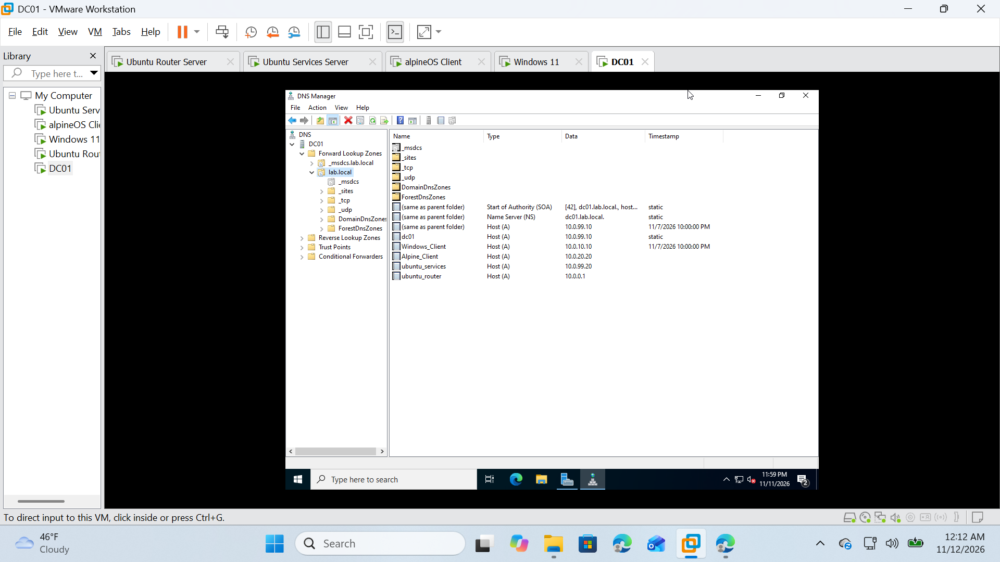
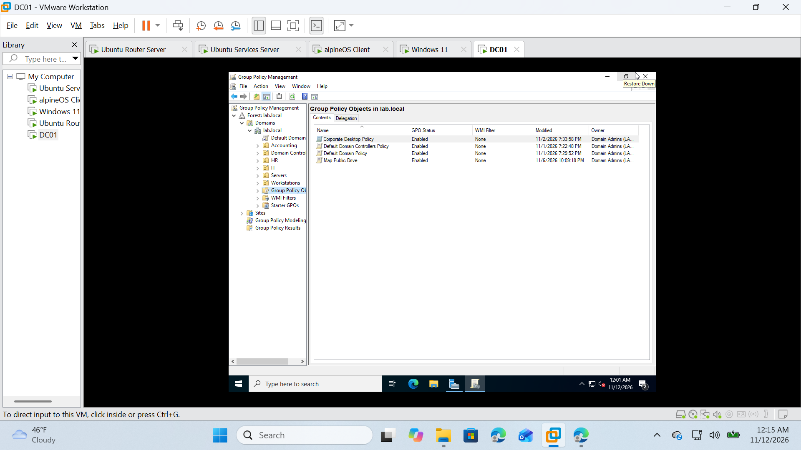
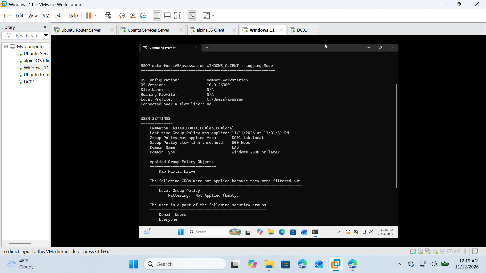
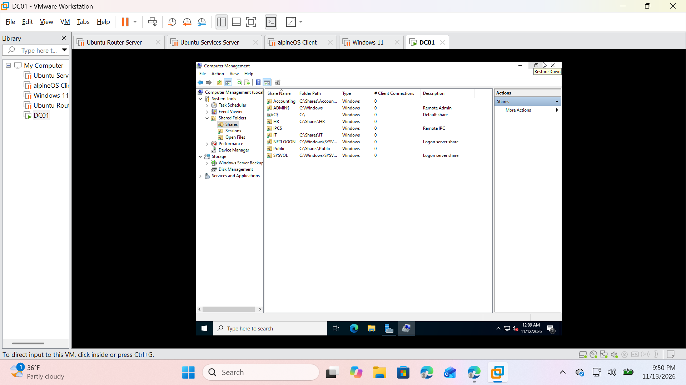
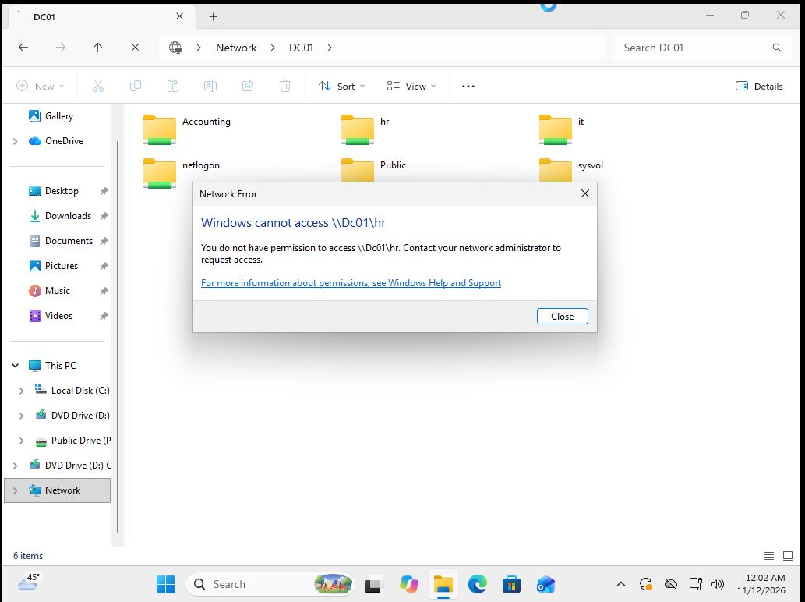
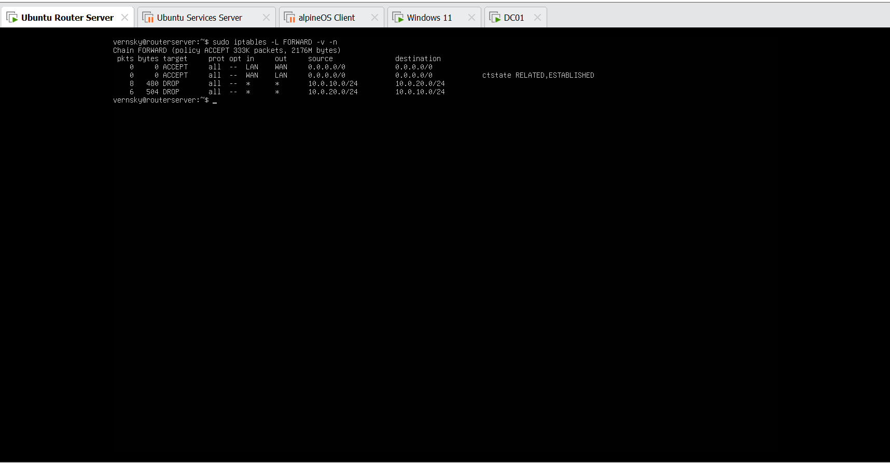
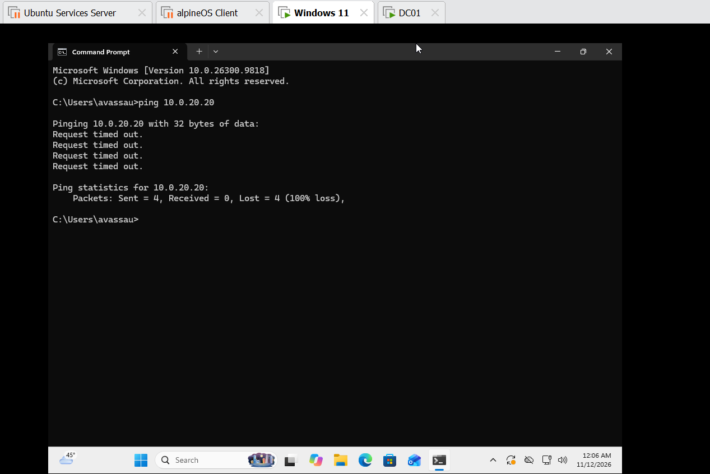
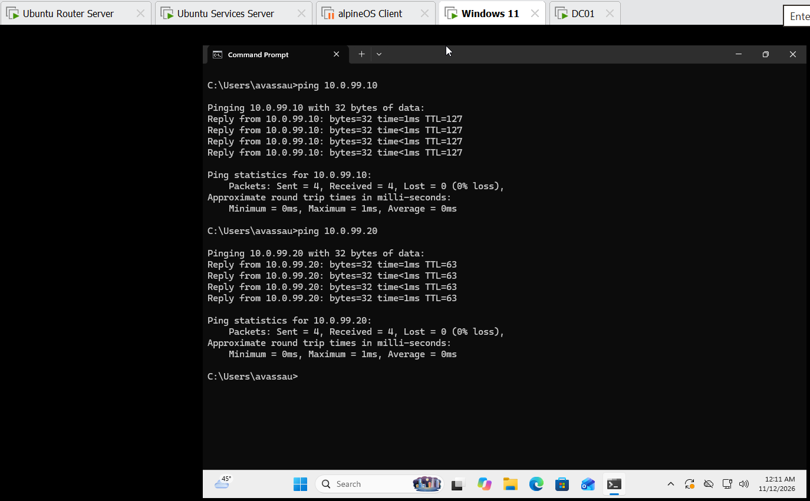

# Virtual_Enterprise_Lab

## Overview

This project documents the design and implementation of a virtual enterprise environment built using VMware Workstation, Windows Server, Windows 11, Ubuntu Server, Alpine Linux, Docker, and Nginx.

The environment simulates a small business network featuring Active Directory, DNS, Group Policy, SMB file shares, Linux-based routing, firewall policies, and network segmentation.

## Technologies Used

- VMware Workstation
- Windows Server
- Windows 11
- Ubuntu Server
- Alpine Linux
- Active Directory Domain Services (AD DS)
- DNS
- DHCP
- Group Policy
- SMB File Sharing
- Docker
- Nginx
- Linux Routing
- iptables
- Network Segmentation

## Network Layout

| Network | Subnet |
|----------|----------|
| IT | 10.0.10.0/24 |
| HR | 10.0.20.0/24 |
| Accounting | 10.0.30.0/24 |
| Servers | 10.0.99.0/24 |

## Key Accomplishments

- Built a Windows Server Active Directory environment.
- Configured DNS, Organizational Units, Security Groups, and Group Policy.
- Implemented SMB file shares with role-based permissions.
- Designed and deployed segmented IT, HR, Accounting, and Server networks.
- Configured Linux-based routing between network segments.
- Implemented firewall-based segmentation using iptables.
- Migrated Active Directory services to a dedicated server subnet.
- Troubleshot DNS, Kerberos, and Group Policy failures.

## Current Environment

### IT Network
- Windows 11
- 10.0.10.10

### HR Network
- Alpine Linux
- 10.0.20.20

### Server Network
- DC01
  - Active Directory
  - DNS
  - Group Policy
  - File Shares
  - 10.0.99.10

- Ubuntu Services
  - Docker
  - Nginx
  - 10.0.99.20

### Router
- Ubuntu Linux
- Inter-subnet Routing
- NAT
- Firewall Policies

## Project Progress

### Phase 1 - Core Infrastructure
- VMware environment deployment
- Ubuntu Router
- BIND9 DNS
- ISC DHCP
- Docker and Nginx services

### Phase 2 - Active Directory
- Windows Server deployment
- Active Directory Domain Services
- DNS integration
- Organizational Units and Security Groups
- SMB file shares
- Group Policy drive mapping

### Phase 3 - Network Segmentation
- IT subnet (10.0.10.0/24)
- HR subnet (10.0.20.0/24)
- Accounting subnet (10.0.30.0/24)
- Server subnet (10.0.99.0/24)
- Linux-based inter-subnet routing
- Firewall segmentation using iptables

### Current Status
✅ Active Directory operational
✅ DNS operational
✅ Group Policy operational
✅ Multi-subnet routing operational
✅ IT/HR segmentation implemented
✅ Project documentation create

## Active Directory Structure

Organizational Units (OUs) were created for IT, HR, Accounting, Servers, and Workstations to support role-based administration and policy management.

---

## Security Groups

Security groups are used to implement role-based access controls throughout the environment.

---

## DNS Configuration

DNS services are hosted on DC01 and provide Active Directory name resolution throughout the environment.

---

## Group Policy Configuration

Group Policy Objects (GPOs) are used to deploy centralized configuration and drive mappings.

---

## Group Policy Validation

Successful Group Policy processing verified from a domain-joined workstation.

---

## SMB File Shares

Departmental file shares were created and secured using Active Directory groups and NTFS permissions.

---

## Access Control Validation

Verification that unauthorized users are prevented from accessing restricted departmental shares.

---

## Router Firewall Rules

iptables firewall policies on the Ubuntu Router enforce network segmentation between departments.

---

## Network Segmentation Validation

Traffic between the IT and HR networks is blocked while maintaining access to shared infrastructure services.

---

## Server Access Validation

Clients retain access to Active Directory, DNS, and shared services after network segmentation is 
