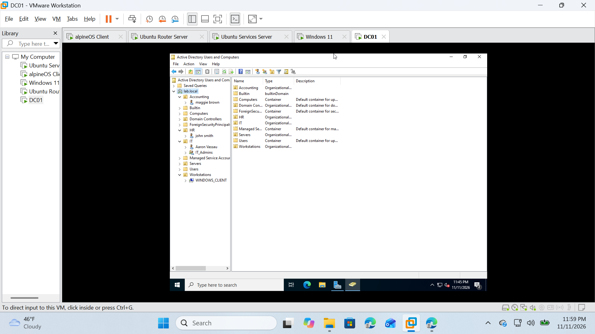
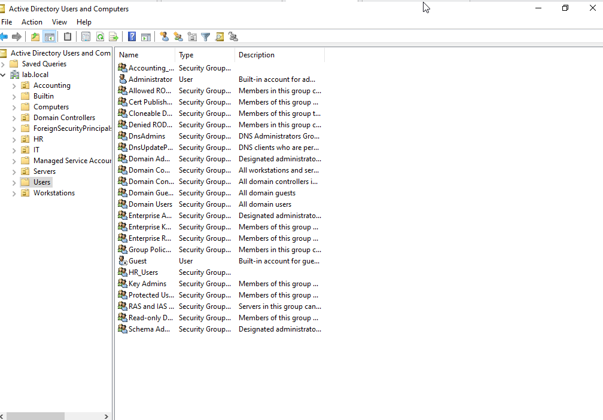
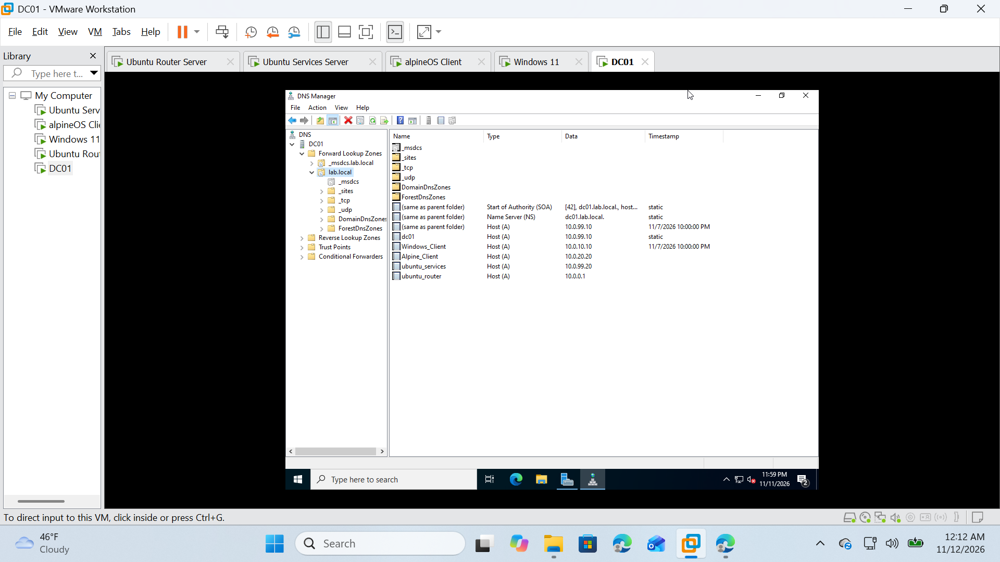
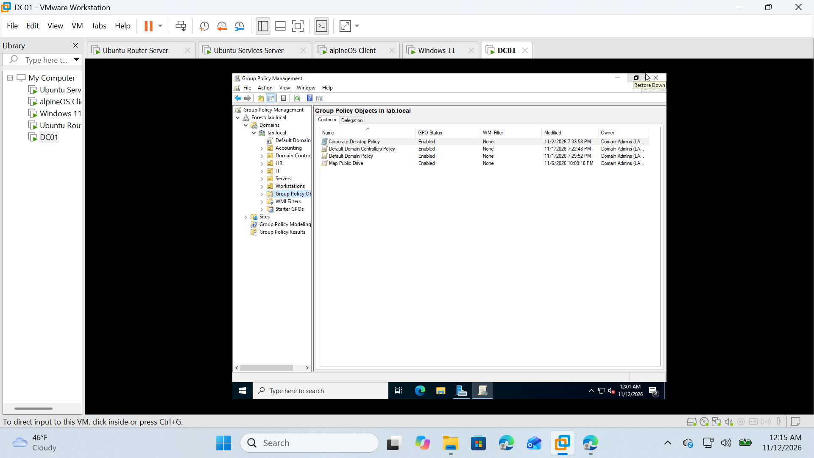
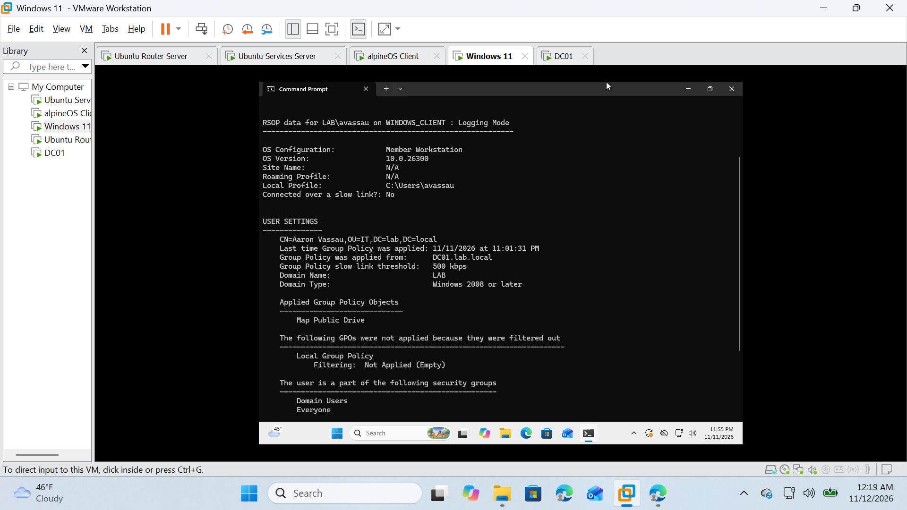
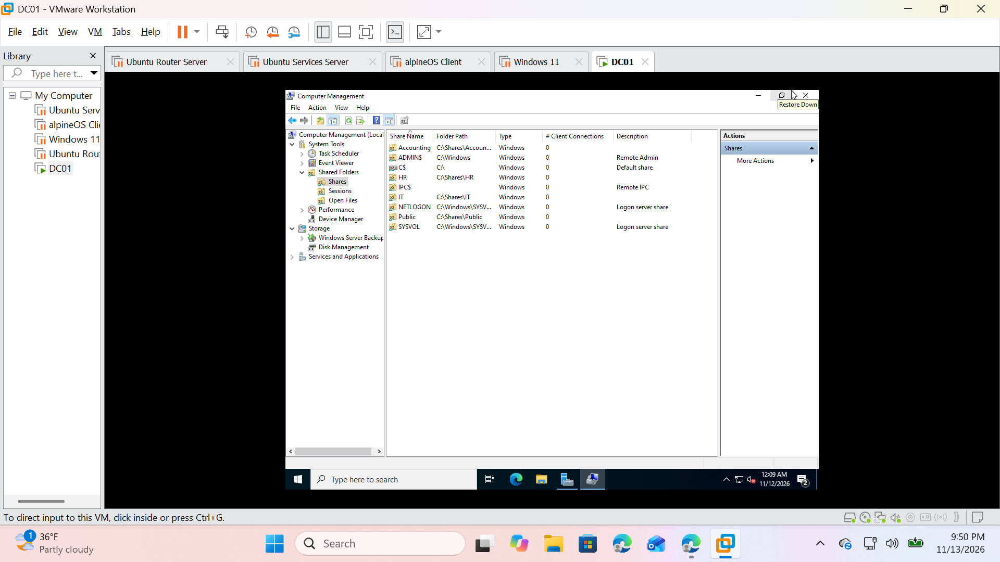
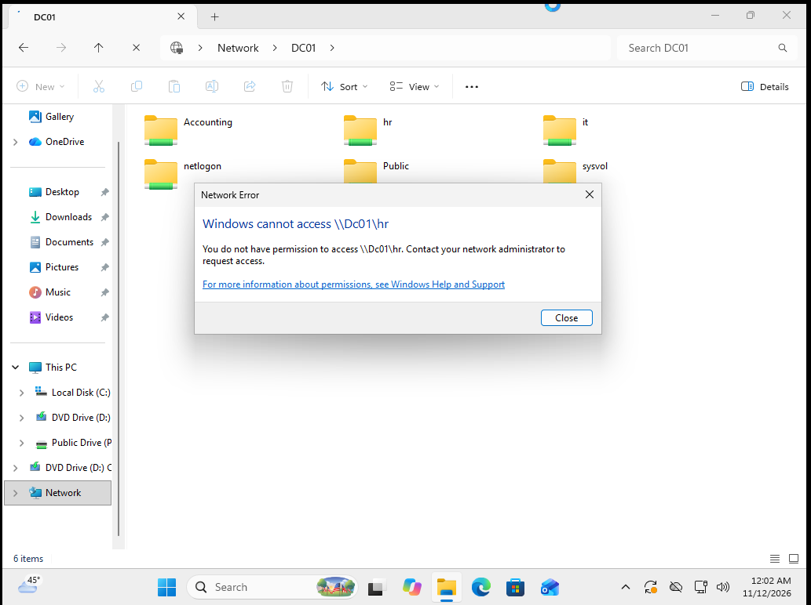
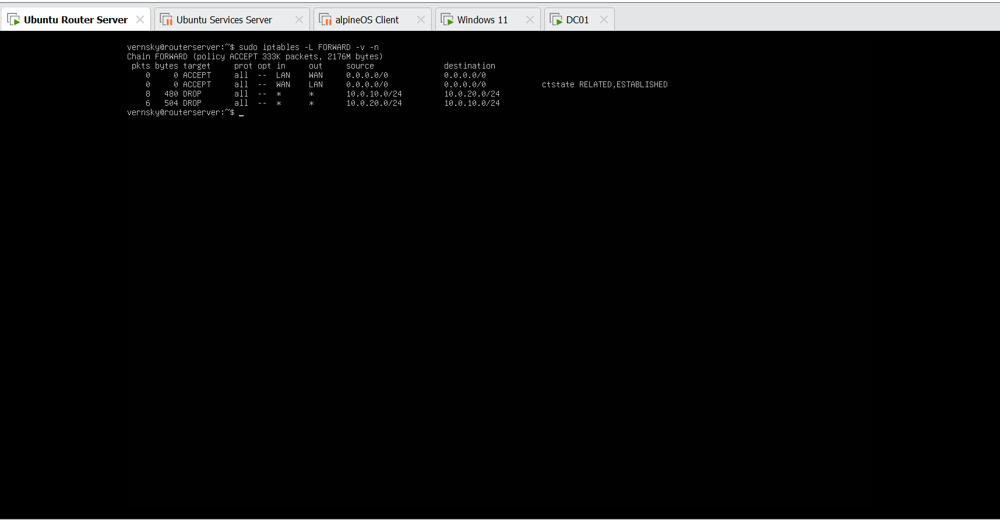
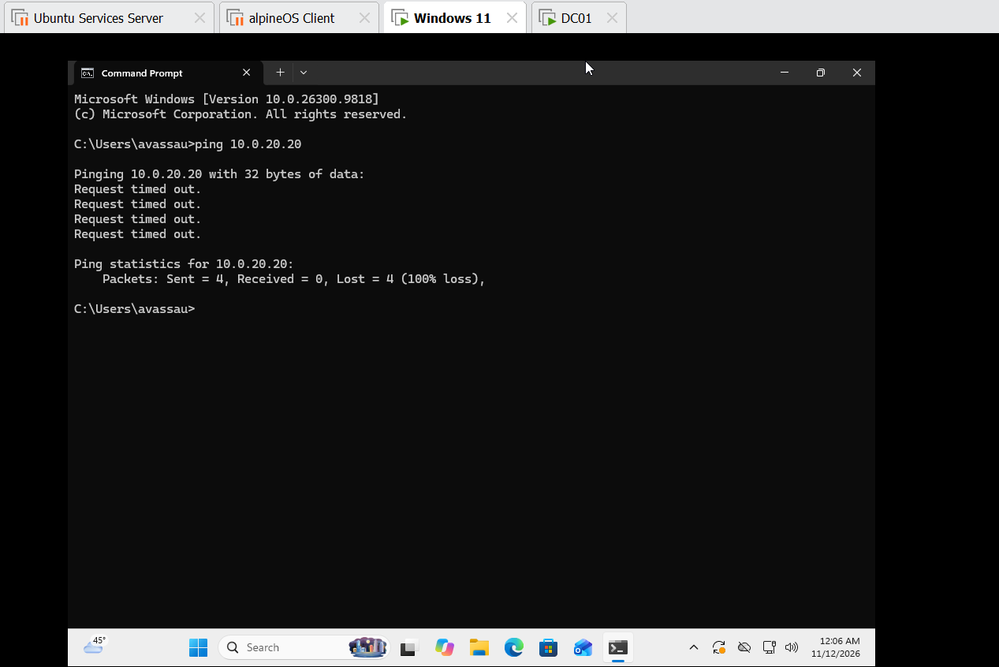
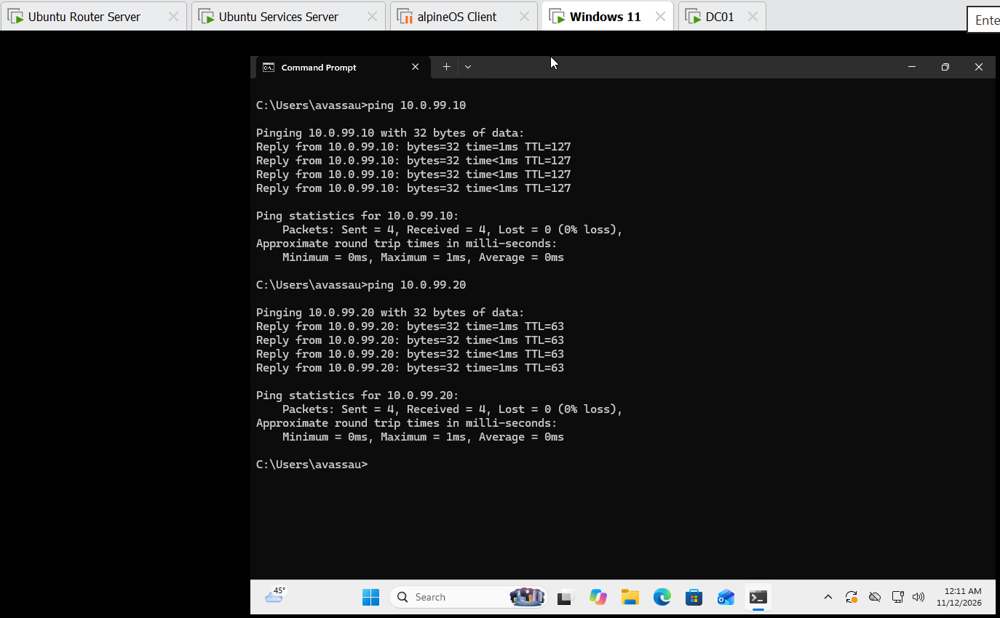

# Virtual_Enterprise_Lab

## Overview

This project documents the design and implementation of a virtual enterprise environment built using VMware Workstation, Windows Server, Windows 11, Ubuntu Server, Alpine Linux, Docker, and Nginx.

The environment was developed to gain hands-on experience with systems administration, networking, virtualization, Active Directory, Linux administration, routing, and network security.

## Technologies Used

- VMware Workstation
- Windows Server
- Active Directory
- DNS
- Group Policy
- SMB File Shares
- Windows 11
- Ubuntu Server
- Alpine Linux
- Docker
- Nginx
- iptables
- Linux Routing
- Subnetting
- Network Segmentation

## Network Design

| Network | Subnet |
|----------|----------|
| IT | 10.0.10.0/24 |
| HR | 10.0.20.0/24 |
| Accounting | 10.0.30.0/24 |
| Servers | 10.0.99.0/24 |

## Infrastructure

### Domain Controller

- Active Directory Domain Services
- DNS
- Group Policy
- File Shares

### Router

Ubuntu-based router providing:

- Inter-subnet routing
- NAT
- Firewall policies
- Network segmentation

### Services Server

- Docker
- Nginx
- Linux services

## Key Accomplishments

- Built a segmented enterprise network
- Implemented Active Directory and Group Policy
- Configured DNS and SMB file shares
- Created role-based access controls
- Implemented firewall-based network segmentation
- Resolved Kerberos, DNS, and GPO authentication issues

## Project Progress

### Phase 1 - Core Infrastructure
- VMware environment deployment
- Ubuntu Router
- BIND9 DNS
- ISC DHCP
- Docker and Nginx services

### Phase 2 - Active Directory
- Windows Server deployment
- Active Directory Domain Services
- DNS integration
- Organizational Units and Security Groups
- SMB file shares
- Group Policy drive mapping

### Phase 3 - Network Segmentation
- IT subnet (10.0.10.0/24)
- HR subnet (10.0.20.0/24)
- Accounting subnet (10.0.30.0/24)
- Server subnet (10.0.99.0/24)
- Linux-based inter-subnet routing
- Firewall segmentation using iptables

### Current Status
✅ Active Directory operational
✅ DNS operational
✅ Group Policy operational
✅ Multi-subnet routing operational
✅ IT/HR segmentation implemented
✅ Project documentation create

## Active Directory Structure

Organizational Units (OUs) were created for IT, HR, Accounting, Servers, and Workstations to support role-based administration and policy management.

---

## Security Groups

Security groups are used to implement role-based access controls throughout the environment.

---

## DNS Configuration

DNS services are hosted on DC01 and provide Active Directory name resolution throughout the environment.

---

## Group Policy Configuration

Group Policy Objects (GPOs) are used to deploy centralized configuration and drive mappings.

---

## Group Policy Validation

Successful Group Policy processing verified from a domain-joined workstation.

---

## SMB File Shares

Departmental file shares were created and secured using Active Directory groups and NTFS permissions.

---

## Access Control Validation

Verification that unauthorized users are prevented from accessing restricted departmental shares.

---

## Router Firewall Rules

iptables firewall policies on the Ubuntu Router enforce network segmentation between departments.

---

## Network Segmentation Validation

Traffic between the IT and HR networks is blocked while maintaining access to shared infrastructure services.

---

## Server Access Validation

Clients retain access to Active Directory, DNS, and shared services after network segmentation is 
